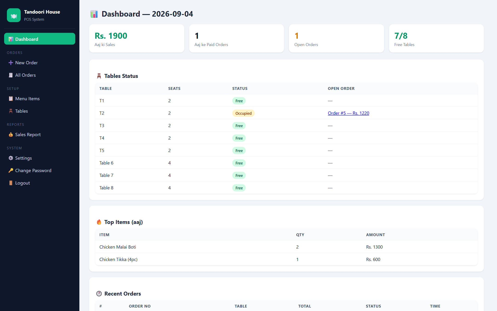

# Restaurant POS & Billing System — Multi-Tenant

Point-of-sale and billing for restaurants, cafés, dhabas, fast food outlets and cloud kitchens — menu, tables, orders, receipts and daily sales, with an **admin panel that manages every client account and keeps each restaurant's data in its own database**.

**[Live demo](https://posdesk.vercel.app)** · Admin: `admin` / `admin123`

## Multi-tenant admin panel

Sign in as admin and open **Users & Clients**:

| Capability | What it does |
|---|---|
| **Create client account** | New username + password per restaurant — the client logs in at the same URL |
| **Open Dashboard** | Impersonate a client to set up their menu and tables for them, with a banner + "Back to my account" |
| **Reset password** | Set a new password for any client without knowing the old one |
| **Role control** | `admin` (full access) or `user` (their own restaurant only) |
| **Delete account** | Removes the login **and** the client's entire database file |
| **Guards** | No self-delete, no self-demotion, last admin protected, duplicate usernames rejected |

**Data isolation:** a central `pos.db` stores only logins; every account gets its own `tenants/u<id>.db` with its menu, tables, orders and settings. One restaurant can never see another's data.

### Demo accounts on the live site

| Login | Password | Workspace |
|---|---|---|
| `admin` | `admin123` | Admin — sees every client in Users & Clients |
| `kfc` | `kfc123` | KFC Restaurant (8 items, 6 tables) |
| `pizza` | `pizza123` | Pizza Point (8 items, 4 tables) |

Try it: sign in as `admin` → Users & Clients → **Open Dashboard** next to KFC. You will see only KFC's menu. Go back and open Pizza Point — a completely different menu.



## Features

**Menu** — categories, prices, dish photos, availability toggle
**Tables** — grid with free/occupied status auto-detected from open orders
**Orders** — touch-friendly screen, table or walk-in, quantities, discounts, GST, live total
**Receipts** — clean A4/receipt layout, print or save as PDF, daily numbering (`R-YYMMDD-0001`)
**Reports** — daily sales, payment methods, category breakdown
**Ops** — settings, password change, automatic daily backups, mobile off-canvas navigation

## Tech stack

Python 3 · Flask · SQLite (multi-tenant, WAL + busy timeout) · Jinja2 · HTML/CSS/JS
Production: Gunicorn + Nginx + systemd on Ubuntu · Demo: Vercel serverless (`/tmp` database)

## Run locally

```bash
python -m venv venv
venv\Scripts\activate        # Windows
pip install -r requirements.txt
python seed_tenants.py       # demo admin + 2 client workspaces
python app.py
```

Open <http://localhost:5001> → `admin` / `admin123`.

## Deploy

- **Vercel:** `vercel --prod` — the bundled central database and `tenants/` are copied to `/tmp` at cold start, so the admin panel and client workspaces work in the demo (data resets when an instance recycles).
- **VPS:** `deploy/` contains the systemd unit and Nginx config; run `gunicorn -w 3 wsgi:app` and keep `pos.db` + `tenants/` on persistent disk.

## Project structure

```
app.py              Flask app — tenant resolution, admin panel, POS routes
wsgi.py             Production entry point (init + seed on import)
schema.sql          Tenant schema (settings, tables, menu, orders, receipts)
seed_tenants.py     Creates demo central DB + three workspaces
templates/          Jinja2 templates (includes users.html admin panel)
static/             CSS, JS
deploy/             systemd unit + Nginx config
standalone/         Older single-restaurant build (no admin panel) for reference
```

## Notes

Change `SECRET_KEY` and the demo passwords before real use. For many clients at scale, move the central database to PostgreSQL.

## License

MIT © 2026 Ahsan Haroon
